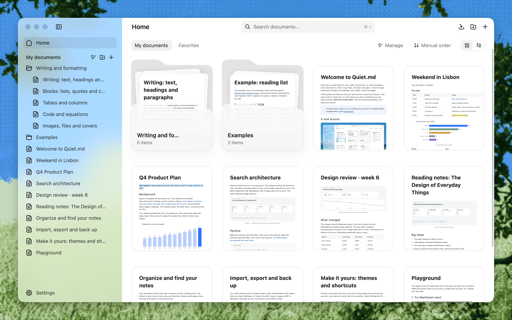

<h1 align="center">Quiet.md</h1>

  <b>Una app de notas local, rápida y tranquila.</b> 
  Dibujada de forma nativa con Rust + GPUI. Tus notas se quedan en tu ordenador, guardadas en el formato DocxXML de Feishu (Lark).

  <a href="README.md">English</a> · <a href="README.zh-CN.md">简体中文</a> · <a href="README.ja.md">日本語</a> · <a href="README.ko.md">한국어</a> · Español · <a href="README.fr.md">Français</a>

  
  
  
  
  
  

  
  &nbsp;
  
  &nbsp;
  

  <a href="https://quiet.md/?lang=en"><b>Sitio web</b></a> ·
  <a href="#descarga"><b>Descarga</b></a> ·
  <a href="#rendimiento">Rendimiento</a> ·
  <a href="#funciones">Funciones</a> ·
  <a href="CONTRIBUTING.md">Contribuir</a>

  

> [!NOTE]
> Quiet.md está en **beta** y cambia rápido. Si encuentras un error o tienes una idea, [abre un issue](https://github.com/s1dashu/quiet-md/issues), o mejor aún, envía un pull request.

## Por qué Quiet.md

**⚡ Rápida, con la rapidez de lo nativo.** Toda la interfaz se dibuja en la GPU con Rust y [GPUI](https://www.gpui.rs/). Sin WebView ni Electron. En un documento de un millón de caracteres, escribir, borrar y desplazarse se mantienen por debajo de 6 ms por fotograma en el P95.

**🔒 Local primero. Tus archivos son tuyos.** Sin cuenta, sin nube y, por defecto, nada sale a la red (salvo la búsqueda de actualizaciones, que es opcional). Tu biblioteca es una carpeta normal en tu ordenador: las carpetas de la barra lateral son carpetas reales y cada nota es un archivo con el nombre de su título (`.xml`, o `.md` para Markdown). Gestiónala con Git, iCloud o la herramienta de sincronización que prefieras; si algún día dejas de usar Quiet.md, tus archivos siguen ahí.

**📝 Un editor de texto enriquecido completo que habla DocxXML de Feishu (Lark).** Las notas se guardan en el formato DocxXML de los documentos de Feishu (Lark), así que copiar y pegar, importar y exportar conservan la estructura. Títulos, tareas, tablas, columnas, destacados, código, ecuaciones, imágenes y adjuntos: están todos los bloques que buscas al escribir documentos.

## Descarga

  
  &nbsp;
  
  &nbsp;
  

| Plataforma | Paquete | Requisitos |
|---|---|---|
| **macOS** (Apple Silicon) | [quiet-md-macos-arm64.zip](https://download.quiet.md/latest/quiet-md-macos-arm64.zip) | macOS 13 o posterior |
| **Windows** (x64) | [quiet-md-windows-x64-setup.exe](https://download.quiet.md/latest/quiet-md-windows-x64-setup.exe) | Windows 10 versión 1809 o posterior |
| **Linux** (x86_64, experimental) | [quiet-md-x86_64.AppImage](https://download.quiet.md/latest/quiet-md-x86_64.AppImage) | glibc 2.35 o posterior (Ubuntu 22.04 o más reciente) |
| **macOS** (Intel) | [quiet-md-macos-x86_64.zip](https://download.quiet.md/latest/quiet-md-macos-x86_64.zip) | macOS 13 o posterior |

- **macOS**: descomprime el archivo y arrastra `quiet.md.app` a Aplicaciones. La app está firmada y notarizada por Apple.
- **Windows**: ejecuta el instalador. Por defecto se instala solo para el usuario actual, y desinstalarla nunca borra tus notas. Si aparece SmartScreen en el primer arranque, haz clic en **Más información → Ejecutar de todas formas**.
- **Linux** (experimental): `chmod +x quiet-md-*.AppImage` y ejecútala; sin FUSE, añade `--appimage-extract-and-run`. La AppImage admite actualizaciones desde la app a partir de la 0.1.10; las versiones de Linux anteriores necesitan una instalación manual una sola vez. Por ahora solo se ha probado a mano en Omarchy con Wayland; consulta las [notas para Linux](CONTRIBUTING.md#linux-experimental).

También puedes descargarla desde [Quiet.md](https://quiet.md/?lang=en). Todas las versiones y sus sumas SHA-256 están en [GitHub Releases](https://github.com/s1dashu/quiet-md/releases).

En el primer arranque eliges el idioma, dónde guardar la biblioteca y el atajo de notas rápidas, y puedes copiar tus notas de Obsidian, Logseq, iA Writer o Typora. Una biblioteca vacía recibe la guía **Getting started**: un recorrido de diez minutos por las funciones principales. Nunca sobrescribe las notas que ya tengas.

La interfaz está disponible en inglés, chino simplificado, japonés, coreano, español y francés.

## Rendimiento

Tiempo de procesamiento por fotograma a lo largo de 100 operaciones seguidas en un documento mixto de **1 millón de caracteres** y 549 capítulos:

| Operación | P50 | P95 |
|---|---:|---:|
| ⌨️ Escribir | **5.06 ms** | 5.78 ms |
| ⌫ Retroceso | **4.99 ms** | 5.55 ms |
| 🖱️ Desplazarse | **2.08 ms** | 4.14 ms |

Una pantalla de 120 Hz da 8.3 ms a cada fotograma. Incluso en el P95 de un documento de un millón de caracteres sobra margen.

| | |
|---|---|
| Descarga para macOS | ~18 MB |
| Instalador para Windows | ~14 MB |
| En ejecución | Sin WebView, sin Electron, sin servicios en segundo plano |

Apple M5 Pro / 48 GiB, macOS 26.5, compilación release. Metodología y scripts para reproducirlo: [docs/PERFORMANCE.md](docs/PERFORMANCE.md).

## Funciones

- **Edición**: títulos, listas numeradas y con viñetas, tareas, citas, bloques de código con resaltado de sintaxis, ecuaciones LaTeX, tablas (con celdas combinadas), destacados, columnas, imágenes, adjuntos y portadas. Atajos de Markdown como `#`, `-`, `[]` y `>`, y un menú `/`.
- **Organización**: árbol de documentos, fijados, favoritos, búsqueda en todo el texto y papelera.
- **Importar y exportar**: importa carpetas de Markdown (con las imágenes incrustadas y los callouts de Obsidian) y DocxXML de Feishu (Lark); exporta a Markdown y PDF, o imprime directamente. Arrastra archivos desde el Finder a Inicio o directamente a una carpeta de la barra lateral. Al pegar desde Feishu o una página web se conserva la estructura.
- **Atajos**: pulsa `⌘ /` (`Ctrl+/` en Windows) para verlos todos. Todos se pueden reasignar. En Windows, Ctrl sustituye a ⌘ y Alt a ⌥; la app y las guías Getting started muestran las teclas de tu sistema.
- **Temas**: cuatro estilos integrados (Craft, Feishu, Notion y Obsidian), cada uno con su variante oscura, o escribe el tuyo en CSS; consulta [docs/THEMES.md](docs/THEMES.md).

## Colaboradores

Gracias a todas las personas que han ayudado a construir Quiet.md. Los issues y pull requests son bienvenidos: cómo compilar, probar y las convenciones de código están en [CONTRIBUTING.md](CONTRIBUTING.md).

## Novedades recientes

- **0.1.12** (14 nov): arrastra archivos desde el Finder, o desde Archivos de este ordenador, directamente a una carpeta de la barra lateral o entre filas; toda la página se ilumina como zona para soltar. Tarjetas de Inicio con esquinas continuas, el menú Abrir en el Finder, rutas que empiezan en Mis documentos, un ancho mínimo de ventana que deja sitio a la nota y una barra lateral opaca en pantalla completa. Corrige un bloqueo al crear un documento dentro de una carpeta.
- **0.1.11** (13 nov): la biblioteca pasa a ser carpetas reales, con archivos nombrados por su título; las bibliotecas anteriores se trasladan solas, con copia de seguridad. Un nuevo primer arranque para elegir idioma, ubicación de la biblioteca y atajo de notas rápidas, e importar notas de Obsidian y otras apps de Markdown. Interfaz en japonés, español y coreano; fórmulas en bloque en Markdown; los documentos se abren donde los dejaste; arranque más rápido y menos memoria.
- **0.1.10** (10 nov): elige el tipo de documento en el menú **Nuevo**, desplaza las tablas anchas en horizontal, conserva la alineación de columnas de Markdown y mantén visible el cursor en los campos largos.
- **0.1.9** (8 nov): corrige Cmd+Q en macOS, los botones de ventana que no respondían en Windows y la selección de texto oculta por los colores de resaltado.
- **0.1.8** (9 nov): edita archivos Markdown locales en su sitio, importa carpetas conservando los `.md` y organiza las notas en carpetas anidadas arrastrando, con deshacer. Menos memoria para imágenes y vistas previas, cambio de tamaño de tablas más estable y menús pulidos. El primer arranque elige un idioma del sistema compatible. Paquete AppImage experimental para Linux.
- **0.1.7** (6 nov): guardado en varias ventanas, recuperación de conflictos y escritura en disco más seguros; acceso a archivos restringido al exportar; las exportaciones a Markdown conservan los adjuntos en línea. Corregido el borrado de texto al escribir chino con Weasel en Windows.
- **0.1.6** (6 nov): cambio de ventana y escritura más fluidos, tablas más anchas, guardado periódico mientras escribes sin parar y Option+Espacio para notas rápidas desde cualquier lugar en macOS. Windows añade pegar imágenes, exportar a PDF e imprimir, y corrige el borrado por palabras.
- **0.1.5** (5 nov): la app pasa a llamarse Quiet.md; tu biblioteca y tus notas siguen donde estaban.
  - Gestiona varios documentos a la vez desde **Inicio**: duplícalos, muévelos o elimínalos juntos.
  - Vacía la papelera de una vez; las flechas recorren los iconos del menú de inserción; eliminar todos los documentos ya no crea uno vacío.
  - Tras actualizar desde la app, la barra lateral muestra una vez qué ha cambiado en la nueva versión.
  - Windows: los atajos y la guía integrada indican Ctrl / Alt, y si el arranque falla se explica el motivo y se deja un registro.
- **0.1.4** (5 nov):
  - Actualizaciones desde la app: cuando sale una versión nueva aparece el botón **Actualizar** en la parte superior de la barra lateral. La descarga se verifica con su firma y un reinicio termina la instalación; antes se guardan los documentos abiertos. La búsqueda automática se puede desactivar en **Ajustes › General**. Solo descarga un manifiesto de versión y no envía ningún dato. Las versiones 0.1.3 y anteriores necesitan descargar la 0.1.4 a mano una vez.
  - Modo oscuro: elige Sistema, Claro u Oscuro en **Ajustes › Apariencia**. Los temas integrados y los personalizados tienen aspecto oscuro; la exportación y la impresión siguen en claro.
- **0.1.3** (4 nov): el texto de la barra lateral vuelve a leerse bien cuando macOS está en modo oscuro.
- **0.1.2** (4 nov): los menús y atajos estándar de macOS (Ocultar, Minimizar, Zoom, Pantalla completa); al hacer clic en el icono del Dock se vuelve a abrir una ventana después de cerrar la última. Corregidos algunos caracteres chinos que se mostraban con glifos incorrectos.
- **0.1.1** (3 nov): primera versión para Windows x64, instalada por usuario y que conserva tus notas al desinstalar. Pulidas la interfaz en chino e inglés y la guía integrada.

Las notas completas de cada versión están en [Releases](https://github.com/s1dashu/quiet-md/releases).

## Licencia

El código se publica bajo la licencia [MIT](LICENSE). El código, las fuentes y los recursos de terceros se enumeran en [THIRD_PARTY.md](THIRD_PARTY.md).

Lo siguiente no está cubierto por la licencia MIT y debe sustituirse en los forks:

- Los 67 iconos de Nucleo en `assets/icons/` están bajo una licencia comercial de Nucleo. No los extraigas ni los redistribuyas por separado.
- El nombre “Quiet.md” y el icono de la app.
