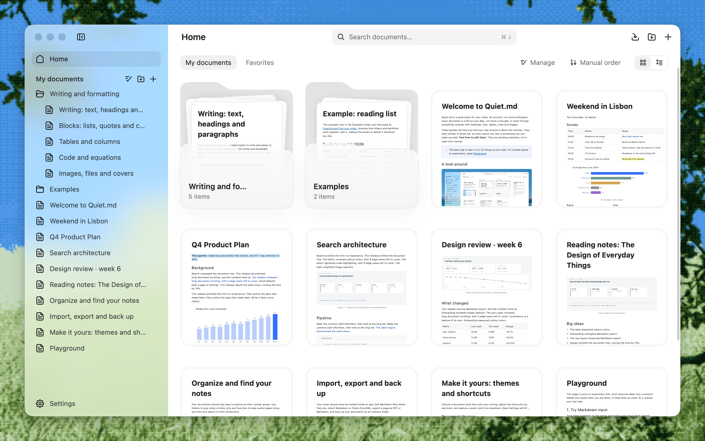

<h1 align="center">Quiet.md</h1>

  <b>Une app de notes locale, rapide et discrète.</b> 
  Conçue nativement en Rust + GPUI. Vos notes restent sur votre ordinateur, au format DocxXML de Feishu (Lark).

  <a href="README.md">English</a> · <a href="README.zh-CN.md">简体中文</a> · <a href="README.ja.md">日本語</a> · <a href="README.ko.md">한국어</a> · <a href="README.es.md">Español</a> · Français

  
  
  
  
  
  

  
  &nbsp;
  
  &nbsp;
  

  <a href="https://quiet.md/?lang=fr"><b>Site web</b></a> ·
  <a href="#téléchargement"><b>Téléchargement</b></a> ·
  <a href="#performances">Performances</a> ·
  <a href="#fonctionnalités">Fonctionnalités</a> ·
  <a href="CONTRIBUTING.md">Contribuer</a>

  

> [!NOTE]
> Quiet.md est en **bêta** et évolue vite. Si vous rencontrez un bug ou avez une idée, [ouvrez une issue](https://github.com/s1dashu/quiet-md/issues), ou mieux, envoyez une pull request.

## Pourquoi Quiet.md

**⚡ Rapide, nativement rapide.** Toute l'interface est dessinée sur le GPU par Rust et [GPUI](https://www.gpui.rs/). Pas de WebView, pas d'Electron. Dans un document d'un million de caractères, la frappe, la suppression et le défilement restent sous 6 ms par image à P95.

**🔒 Local d'abord. Vos fichiers vous appartiennent.** Aucun compte, aucun cloud, et rien ne passe par le réseau par défaut (hormis la vérification facultative des mises à jour). Votre bibliothèque est un dossier ordinaire sur votre ordinateur : les dossiers de la barre latérale sont de vrais dossiers, et chaque note est un fichier nommé d'après son titre (`.xml`, ou `.md` pour le Markdown). Gérez-la avec Git, iCloud ou l'outil de synchronisation de votre choix. Si vous cessez un jour d'utiliser Quiet.md, vos fichiers seront toujours là.

**📝 Un éditeur de texte enrichi complet qui parle le DocxXML de Feishu (Lark).** Les notes sont enregistrées au format DocxXML utilisé par les documents Feishu (Lark), pour que copier-coller, import et export conservent leur structure. Titres, tâches, tableaux, colonnes, encadrés, code, math, images et pièces jointes : tous les blocs utiles à l'écriture de documents sont là.

## Téléchargement

  
  &nbsp;
  
  &nbsp;
  

| Plateforme | Paquet | Prérequis |
|---|---|---|
| **macOS** (Apple Silicon) | [quiet-md-macos-arm64.zip](https://download.quiet.md/latest/quiet-md-macos-arm64.zip) | macOS 13 ou ultérieur |
| **Windows** (x64) | [quiet-md-windows-x64-setup.exe](https://download.quiet.md/latest/quiet-md-windows-x64-setup.exe) | Windows 10 version 2004 ou ultérieure |
| **Linux** (x86_64, expérimental) | [quiet-md-x86_64.AppImage](https://download.quiet.md/latest/quiet-md-x86_64.AppImage) | glibc 2.35 ou ultérieure (Ubuntu 22.04 et plus récent) |
| **macOS** (Intel) | [quiet-md-macos-x86_64.zip](https://download.quiet.md/latest/quiet-md-macos-x86_64.zip) | macOS 13 ou ultérieur |

- **macOS** : décompressez l'archive et glissez `quiet.md.app` dans Applications. L'app est signée et notariée par Apple.
- **Windows** : lancez l'installateur. Par défaut, l'installation est limitée à l'utilisateur courant, et la désinstallation ne supprime jamais vos notes. Si SmartScreen apparaît au premier lancement, cliquez sur **Plus d'infos → Exécuter quand même**.
- **Linux** (expérimental) : `chmod +x quiet-md-*.AppImage` puis lancez-le. Sans FUSE, ajoutez `--appimage-extract-and-run`. Les AppImage 0.1.10 et plus récentes prennent en charge la mise à jour depuis l'app. Les versions Linux plus anciennes nécessitent une installation manuelle unique. Les tests interactifs ont jusqu'ici porté sur Omarchy sous Wayland (voir les [notes Linux](CONTRIBUTING.md#linux-experimental)).

Vous pouvez aussi télécharger depuis [Quiet.md](https://quiet.md/?lang=fr). Chaque version et ses sommes de contrôle SHA-256 sont sur [GitHub Releases](https://github.com/s1dashu/quiet-md/releases).

Au premier lancement, Quiet.md demande la langue de l'interface, l'emplacement de votre bibliothèque et le raccourci de note rapide, et propose de copier vos notes depuis Obsidian, Logseq, iA Writer ou Typora. Une bibliothèque vide reçoit le guide **Getting started** : une visite de dix minutes des principales fonctionnalités. Les notes existantes ne sont jamais écrasées.

L'interface est disponible en anglais, chinois simplifié, japonais, coréen, espagnol et français.

## Performances

Temps de traitement par image sur 100 opérations consécutives dans un document mixte d'**un million de caractères** et 549 chapitres :

| Opération | P50 | P95 |
|---|---:|---:|
| ⌨️ Saisie | **5,06 ms** | 5,78 ms |
| ⌫ Retour arrière | **4,99 ms** | 5,55 ms |
| 🖱️ Défilement | **2,08 ms** | 4,14 ms |

Un écran 120 Hz laisse 8,3 ms par image. Même à P95 sur un document d'un million de caractères, il reste de la marge.

| | |
|---|---|
| Téléchargement macOS | ~18 Mo |
| Installateur Windows | ~14 Mo |
| Exécution | Pas de WebView, pas d'Electron, pas de services en arrière-plan |

Apple M5 Pro / 48 Go, macOS 26.5, build release. Méthodologie et scripts de reproduction : [docs/PERFORMANCE.md](docs/PERFORMANCE.md).

## Fonctionnalités

- **Édition** : titres, listes numérotées et à puces, tâches, citations, blocs de code avec coloration syntaxique, math LaTeX, tableaux (avec cellules fusionnées), encadrés, colonnes, images, pièces jointes et couvertures. Raccourcis Markdown comme `#`, `-`, `[]` et `>`, plus un menu barre oblique `/`.
- **Organisation** : arborescence de documents, épinglage, favoris, recherche plein texte et corbeille.
- **Import et export** : importez des dossiers Markdown (images intégrées et encadrés Obsidian inclus) et du DocxXML Feishu (Lark). Exportez en Markdown et PDF, ou imprimez directement. Glissez des fichiers depuis le Finder vers l'accueil ou directement dans un dossier de la barre latérale. Un collage depuis Feishu ou une page web conserve la structure.
- **Raccourcis** : appuyez sur `⌘ /` (`Ctrl+/` sous Windows) pour tous les voir. Chacun est reconfigurable. Sous Windows, Ctrl remplace ⌘ et Alt remplace ⌥. L'app et les guides de prise en main affichent les touches de votre système.
- **Thèmes** : quatre styles intégrés, Craft, Feishu, Notion et Obsidian, chacun avec une variante sombre, ou écrivez le vôtre en CSS (voir [docs/THEMES.md](docs/THEMES.md)).

## Contributeurs

Merci à toutes les personnes qui ont contribué à construire Quiet.md. Issues et pull requests sont bienvenues : compilation, tests et conventions de code sont dans [CONTRIBUTING.md](CONTRIBUTING.md).

## Dernières mises à jour

- **0.1.12** (14 nov) : glissez des fichiers depuis le Finder, ou un fichier de « Fichiers de cet ordinateur », directement dans un dossier de la barre latérale ou entre deux lignes. Toute la page s'illumine comme zone de dépôt. Cartes de l'accueil redessinées avec des coins arrondis continus, un menu Ouvrir dans le Finder, un fil d'Ariane qui commence à « Mes documents », une largeur minimale de fenêtre qui garde de la place pour la note, et une barre latérale opaque en plein écran. Corrige un blocage lors de la création d'un document dans un dossier.
- **0.1.11** (13 nov) : la bibliothèque est désormais de vrais dossiers, avec des fichiers nommés d'après leur titre. Les anciennes bibliothèques migrent automatiquement, avec une sauvegarde. Un premier lancement nouveau qui règle la langue, l'emplacement de la bibliothèque et le raccourci de note rapide, et importe les notes depuis Obsidian et les autres apps Markdown. Interface en japonais, espagnol et coréen, équations en bloc dans le Markdown, documents qui se rouvrent là où vous les avez laissés, lancement plus rapide et mémoire réduite.
- **0.1.10** (10 nov) : choix d'un type de document dans le menu Nouveau, défilement horizontal des tableaux larges, conservation de l'alignement des colonnes Markdown, et curseur toujours visible dans les champs longs.
- **0.1.9** (8 nov) : correction de Cmd+Q sur macOS, des contrôles de fenêtre inertes sous Windows, et de la sélection de texte masquée par les couleurs de surlignage.
- **0.1.8** (9 nov) : édition de fichiers Markdown locaux sur place, import de dossiers en conservant les `.md`, et organisation des notes en dossiers imbriqués par glisser-déposer avec annulation. Mémoire d'images et d'aperçus réduite, redimensionnement des tableaux plus stable et menus affinés. Le premier lancement choisit une langue système prise en charge. Empaquetage AppImage Linux expérimental.
- **0.1.7** (6 nov) : enregistrement multi-fenêtres, récupération de conflits et écritures disque plus sûrs. Accès aux fichiers d'export restreint, et les exports Markdown conservent les pièces jointes en ligne. Correction de la suppression de caractères en saisie chinoise avec Weasel sous Windows.
- **0.1.6** (6 nov) : bascule entre fenêtres et frappe plus fluides, tableaux plus larges, enregistrements réguliers pendant la saisie continue, et Option+Espace pour la note rapide globale sur macOS. Windows ajoute le collage d'images, l'export PDF et l'impression, avec une suppression de mots corrigée.
- **0.1.5** (5 nov) : l'app s'appelle désormais Quiet.md. Votre bibliothèque et vos notes restent où elles étaient.
  - Gérez plusieurs documents à la fois depuis l'accueil : dupliquer, déplacer ou supprimer ensemble.
  - Videz la Corbeille en une seule étape. Les flèches parcourent les icônes du menu d'insertion, et supprimer tous les documents ne crée plus de document vide.
  - Après une mise à jour depuis l'app, la barre latérale affiche une fois ce qui a changé dans la nouvelle version.
  - Windows : les raccourcis et le guide intégré affichent Ctrl / Alt, et un lancement raté s'explique et laisse un journal.
- **0.1.4** (5 nov) :
  - Mises à jour depuis l'app : quand une nouvelle version sort, un bouton **Mettre à jour** apparaît en haut de la barre latérale. Le téléchargement est vérifié par sa signature, et un redémarrage termine l'installation. Les documents ouverts sont d'abord enregistrés. Les vérifications automatiques se désactivent dans **Réglages › Général**. Une vérification ne récupère qu'un manifeste de version et n'envoie aucune donnée. Les versions 0.1.3 et antérieures nécessitent un téléchargement manuel unique de la 0.1.4.
  - Mode sombre : choisissez Système, Clair ou Sombre dans **Réglages › Apparence**. Les thèmes intégrés et personnalisés ont tous un habillage sombre, mais l'export et l'impression restent clairs.
- **0.1.3** (4 nov) : le texte de la barre latérale est de nouveau lisible quand macOS est en mode sombre.
- **0.1.2** (4 nov) : les menus et raccourcis macOS standard (Masquer, Placer dans le Dock, Zoom, Plein écran). Cliquer sur l'icône du Dock rouvre une fenêtre après la fermeture de la dernière. Correction de certains caractères chinois rendus avec les mauvais glyphes.
- **0.1.1** (3 nov) : première version Windows x64, installée par utilisateur, qui conserve vos notes à la désinstallation. Interface chinoise et anglaise et guide intégré peaufinés.

Les notes complètes de chaque version sont sur [Releases](https://github.com/s1dashu/quiet-md/releases).

## Licence

Le code est sous licence [MIT](LICENSE). Le code, les polices et les ressources tiers sont listés dans [THIRD_PARTY.md](THIRD_PARTY.md).

Les éléments suivants ne sont pas couverts par la licence MIT et doivent être remplacés dans les forks :

- Les 67 icônes Nucleo de `assets/icons/` sont sous une licence Nucleo commerciale. Ne les extrayez pas et ne les redistribuez pas seules.
- Le nom « Quiet.md » et l'icône de l'app.
