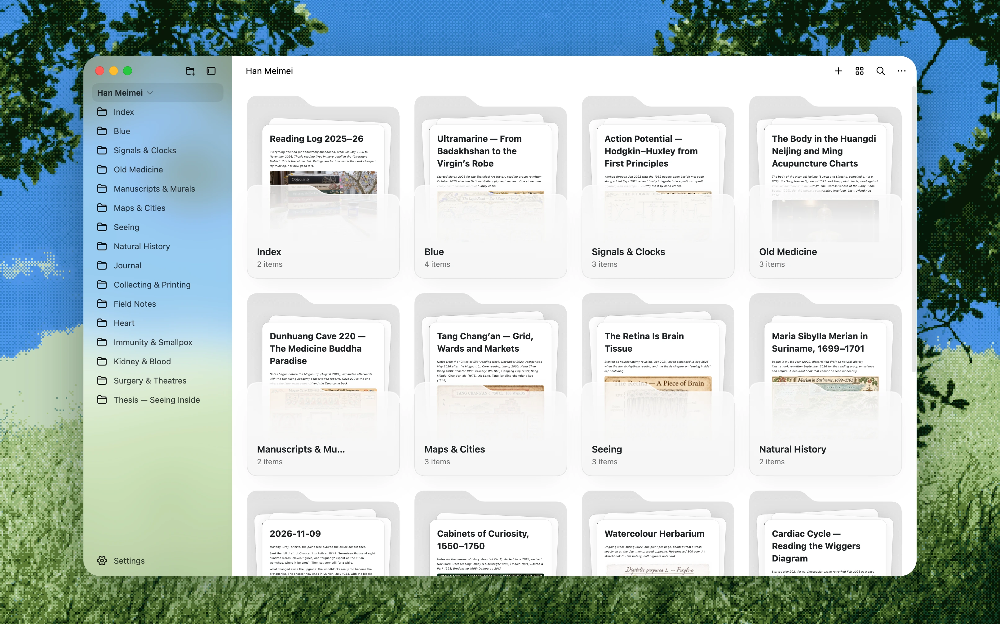

<h1 align="center">Quiet.md</h1>

  <b>Des notes rapides et discrètes, qui vivent sur votre ordinateur.</b> 
  Une app de notes native écrite en Rust + GPUI : de vrais dossiers, du Markdown qui se met en forme tout seul et un tableau blanc dans vos notes. Gratuite et open source.

  <a href="README.md">English</a> · <a href="README.zh-CN.md">简体中文</a> · <a href="README.zh-TW.md">繁體中文</a> · <a href="README.ja.md">日本語</a> · <a href="README.ko.md">한국어</a> · <a href="README.es.md">Español</a> · Français · <a href="README.vi.md">Tiếng Việt</a>

  
  
  
  
  
  

  
  &nbsp;
  
  &nbsp;
  

  <a href="https://quiet.md/?lang=fr"><b>Site web</b></a> ·
  <a href="#téléchargement"><b>Téléchargement</b></a> ·
  <a href="#fonctionnalités">Fonctionnalités</a> ·
  <a href="#performances">Performances</a> ·
  <a href="CONTRIBUTING.md">Contribuer</a>

  

> [!NOTE]
> Quiet.md est en **bêta** et évolue vite. Si vous rencontrez un bug ou avez une idée, [ouvrez une issue](https://github.com/s1dashu/quiet-md/issues), ou mieux, envoyez une pull request.

## Pourquoi Quiet.md

**📁 Vos notes sont de simples fichiers.** Pas de compte, pas de cloud, et rien ne part sur le réseau par défaut (hors vérification facultative des mises à jour, comptes d'utilisation anonymes envoyés une fois par jour par l'app et l'outil en ligne de commande `quiet` — seulement des comptes, comme le nombre d'ouvertures de l'app ; à désactiver dans Réglages › Général › Statistiques d'utilisation anonymes — et polices que vous déclenchez : la police manuscrite pour le chinois, le japonais et le coréen la première fois qu'un tableau blanc en a besoin, et une police de document téléchargeable quand vous la choisissez). Chaque dossier de la barre latérale est un vrai dossier sur votre disque, et chaque note est un fichier nommé d'après son titre : `.md` pour le Markdown, `.xml` pour les documents enrichis. Synchronisez-les avec iCloud, Git ou l'outil de votre choix. Si vous arrêtez un jour d'utiliser Quiet.md, vos fichiers restent exactement où ils sont.

**⚡ Native, et rapide.** Toute l'interface est dessinée sur le GPU par Rust et [GPUI](https://www.gpui.rs/). Ni Electron, ni WebView. Dans une note d'un million de caractères, la frappe prend environ 5 ms par image, quand un écran à 120 Hz en accorde 8,3.

**✍️ Écrire et dessiner au même endroit.** Tapez `#`, `-`, `[]` ou `>` et le Markdown se met en forme tout seul. Quand les mots ne suffisent plus, placez un tableau blanc directement dans la note. Les notes enrichies sont enregistrées au format DocxXML de Feishu (Lark) : un collage depuis Feishu ou une page web garde sa structure.

## Fonctionnalités

### Écrire

  

Titres, listes, tâches, citations, encadrés, colonnes, tableaux avec cellules fusionnées, code avec coloration syntaxique, formules LaTeX, images, fichiers et couvertures. Les raccourcis Markdown fonctionnent pendant la frappe, et le menu `/` propose tout le reste. Mentionnez une autre note pour y faire un lien ; elle affichera ses rétroliens. Les blocs de code Mermaid s'affichent en diagrammes. Les tableaux de données rangent des fiches avec des champs de choix, date, nombre, formule, recherche et lien, dans des vues que vous filtrez, triez et groupez ; chaque cellule d'une colonne Notes est une vraie note. Le menu … propose Mode concentration, Mode machine à écrire et Focus sur le paragraphe, et Présentation › Zoom avant agrandit le texte seul.

### Dessiner

  

Les tableaux sont un tableau blanc porté d'Excalidraw : formes, flèches qui restent attachées, dessin à main levée, texte, notes adhésives, cadres et images. Placez-en un dans une note, ou gardez-le comme fichier `.excalidraw` qu'excalidraw.com sait ouvrir. Zoomez en pinçant le trackpad ; un tableau de 10 000 formes reste fluide.

### Ranger dans de vrais dossiers

La barre latérale regroupe vos dossiers de premier niveau ; ouvrez-en un, et sa page montre les sous-dossiers en piles de leurs pages, et la vue en liste se trie par n'importe quelle colonne. Ajoutez n'importe quel dossier de votre ordinateur avec **Ajouter un dossier** : il s'utilise sur place. Maintenez une note au-dessus d'un dossier et il s'ouvre tout seul ; les dossiers s'imbriquent, pages et dossiers passent d'un dossier de premier niveau à un autre, et chaque déplacement s'annule. Épinglez des notes en haut de la barre latérale, cherchez dans tous les titres et toutes les lignes depuis l'icône de recherche ou avec `⌘ J`, et faites des rechercher-remplacer dans une note, expressions régulières comprises. Les notes supprimées attendent dans la corbeille le nombre de jours que vous choisissez. Un fichier Markdown ouvert seul se modifie dans sa propre fenêtre, sur place.

### Apporter vos notes

Importer depuis une autre app… (dans le menu Fichier) cherche sur l'ordinateur vos bibliothèques Obsidian, Logseq, iA Writer et Typora et vos espaces de travail SiYuan, et les copie sans toucher aux originaux. Les `[[liens wiki]]` d'Obsidian continuent de fonctionner : cliquez sur l'un d'eux pour ouvrir la note visée. Ensuite, glissez des fichiers et dossiers Markdown sur la page d'un dossier ou directement dans un dossier de la barre latérale. Les notes repartent en Markdown ou en PDF, ou directement vers l'imprimante.

### Et aussi

- **Historique des versions** : chaque note garde des instantanés à l'enregistrement (20 par défaut, jusqu'à 30). Ouvrez-en un pour voir sur place ce qui a changé, restaurez-le en un clic ou donnez-lui un nom.
- **Notes rapides** : sur macOS, un raccourci global (`⌥ Espace` par défaut) ouvre une petite fenêtre de note par-dessus n'importe quelle app.
- **Votre style** : quatre styles intégrés — Craft, Feishu, Notion et Obsidian —, chacun avec une variante sombre, ou votre propre CSS ([docs/THEMES.md](docs/THEMES.md)). Choisissez la police de l'interface et celle des documents.
- **Vos touches** : appuyez sur `⌘ /` pour voir tous les raccourcis et réaffecter ou effacer n'importe lequel. Sous Windows et Linux, Ctrl remplace ⌘ et Alt remplace ⌥.
- **Ligne de commande et agents** : l'outil `quiet`, fourni avec l'app, permet à des agents d'IA comme Claude Code ou Codex de lire et modifier votre bibliothèque avec le même moteur que l'app. Réglages › Connecteur d'agent donne une ligne à coller à votre agent, qui s'installe tout seul ; sur macOS, l'outil s'installe en un clic. Détails dans le [README en anglais](README.md#work-with-agents).
- **Votre langue** : anglais, chinois simplifié, chinois traditionnel, japonais, coréen, espagnol, français, arabe et turc. L'arabe lie ses lettres et s'écrit de droite à gauche.
- **Ménage** : Réglages › Bibliothèque repère les images et fichiers qu'aucune note n'utilise plus et les retire une fois que vous avez confirmé.
- **Mises à jour** : les nouvelles versions s'installent depuis l'app après vérification de leur signature. Les vérifications automatiques peuvent être désactivées.

## Feuille de route

- [x] Documents riches : titres, listes, encadrés, tableaux, colonnes, code, formules, images et fichiers
- [x] Fichiers Markdown, ouverts et modifiés sur place
- [x] Tableaux blancs : schémas et croquis à main levée, dans les notes ou à part
- [x] Ouvrir n'importe quel dossier sur place, côte à côte dans la barre latérale
- [x] Import depuis Obsidian, Logseq, SiYuan, Typora, iA Writer et tout dossier Markdown
- [x] Modes d'écriture : concentration, machine à écrire et focus sur le paragraphe
- [x] Thèmes, mode sombre et neuf langues
- [x] Une CLI `quiet` et une skill pour les agents d'IA
- [ ] Tables de données (en cours)
- [ ] Diagrammes Mermaid (en cours)
- [ ] Mobile : iPhone, iPad et Android (en cours)
- [ ] Synchronisation entre appareils (en cours)
- [ ] Propriétés de document
- [ ] Capture de pages web

## Téléchargement

  
  &nbsp;
  
  &nbsp;
  

| Plateforme | Paquet | Prérequis |
|---|---|---|
| **macOS** (Apple Silicon) | [quiet-md-macos-arm64.dmg](https://download.quiet.md/latest/quiet-md-macos-arm64.dmg) | macOS 13 ou ultérieur |
| **Windows** (x64) | [quiet-md-windows-x64-setup.exe](https://download.quiet.md/latest/quiet-md-windows-x64-setup.exe) | Windows 10 version 2004 ou ultérieure |
| **Linux** (x86_64, expérimental) | [quiet-md-x86_64.AppImage](https://download.quiet.md/latest/quiet-md-x86_64.AppImage) | glibc 2.35 ou ultérieure (Ubuntu 22.04 et plus récent) |
| **macOS** (Intel) | [quiet-md-macos-x86_64.dmg](https://download.quiet.md/latest/quiet-md-macos-x86_64.dmg) | macOS 13 ou ultérieur |

- **macOS** : ouvrez le `.dmg`, glissez `quiet.md.app` sur le raccourci Applications à côté, puis ouvrez-la depuis Applications. L'app et l'image disque sont signées et notariées par Apple. Le `.zip` de la page Releases contient la même app ; c'est lui que télécharge la mise à jour intégrée.
- **Windows** : lancez l'installateur. Par défaut, l'installation est limitée à l'utilisateur courant, et la désinstallation ne supprime jamais vos notes. Si SmartScreen apparaît au premier lancement, cliquez sur **Plus d'infos → Exécuter quand même**.
- **Linux** (expérimental) : `chmod +x quiet-md-*.AppImage` puis lancez-le. Sans FUSE, ajoutez `--appimage-extract-and-run`. Les AppImage 0.1.10 et plus récentes prennent en charge la mise à jour depuis l'app. Les versions Linux plus anciennes nécessitent une installation manuelle unique. Les tests interactifs ont jusqu'ici porté sur Omarchy sous Wayland (voir les [notes Linux](CONTRIBUTING.md#linux-experimental)).

Vous pouvez aussi télécharger depuis [Quiet.md](https://quiet.md/?lang=fr). Chaque version et ses sommes de contrôle SHA-256 sont sur [GitHub Releases](https://github.com/s1dashu/quiet-md/releases).

Au premier lancement, Quiet.md ouvre directement un dossier **Quiet Notes** dans vos Documents (ou le dossier `Quiet.md` qu'une version précédente y a créé), avec le guide **Getting started** : une visite de dix minutes des principales fonctionnalités. Les notes existantes ne sont jamais écrasées. Ajoutez d'autres dossiers ou importez les notes d'autres apps quand vous voulez, depuis le menu Fichier.

## Performances

Temps de traitement par image sur 100 opérations consécutives dans un document mixte d'**un million de caractères** et 549 chapitres :

| Opération | P50 | P95 |
|---|---:|---:|
| ⌨️ Saisie | **5,06 ms** | 5,78 ms |
| ⌫ Retour arrière | **4,99 ms** | 5,55 ms |
| 🖱️ Défilement | **2,08 ms** | 4,14 ms |

Un écran 120 Hz laisse 8,3 ms par image. Même à P95 sur un document d'un million de caractères, il reste de la marge.

| | |
|---|---|
| Téléchargement macOS | ~18 Mo |
| Installateur Windows | ~14 Mo |
| Exécution | Pas de WebView, pas d'Electron, pas de services en arrière-plan |

Apple M5 Pro / 48 Go, macOS 26.5, build release. Méthodologie et scripts de reproduction : [docs/PERFORMANCE.md](docs/PERFORMANCE.md).

## Contributeurs

Merci à toutes les personnes qui ont contribué à construire Quiet.md. Issues et pull requests sont bienvenues : compilation, tests et conventions de code sont dans [CONTRIBUTING.md](CONTRIBUTING.md).

## Dernières mises à jour

- **0.1.14** (22 nov) : rechercher-remplacer avec des expressions régulières. Les `[[liens wiki]]` d'Obsidian ouvrent la note visée. Interface en turc, et l'arabe s'affiche de droite à gauche. Choisissez la police de l'interface et celle des documents, et retirez les images et fichiers qu'aucune note n'utilise. La recherche suit dans les grandes bibliothèques, et supprimer beaucoup de notes est plus rapide. Un réglage pour que Retour arrière revienne au titre ; sous Windows et Linux, Copier en Markdown devient Ctrl+Maj+M.
- **0.1.13** (17 nov) : tableaux blancs portés depuis Excalidraw, comme bloc dans une note ou fichier `.excalidraw`, fluides même avec 10 000 formes. Historique des versions pour chaque note (… › Historique des versions). Interfaces en français et en arabe. Copier en Markdown, copier le chemin d'un fichier et changer de dossier de bibliothèque dans les Réglages. Les images collées depuis le web sont enregistrées dans la bibliothèque. Moins de mémoire sur les pages riches en images et un défilement plus fluide de la barre latérale.
- **0.1.12** (14 nov) : glissez des fichiers depuis le Finder, ou un fichier de « Fichiers de cet ordinateur », directement dans un dossier de la barre latérale ou entre deux lignes. Toute la page s'illumine comme zone de dépôt. Cartes de l'accueil redessinées avec des coins arrondis continus, un menu Ouvrir dans le Finder, un fil d'Ariane qui commence à « Mes documents », une largeur minimale de fenêtre qui garde de la place pour la note, et une barre latérale opaque en plein écran. Corrige un blocage lors de la création d'un document dans un dossier.
- **0.1.11** (13 nov) : la bibliothèque est désormais de vrais dossiers, avec des fichiers nommés d'après leur titre. Les anciennes bibliothèques migrent automatiquement, avec une sauvegarde. Un premier lancement nouveau qui règle la langue, l'emplacement de la bibliothèque et le raccourci de note rapide, et importe les notes depuis Obsidian et les autres apps Markdown. Interface en japonais, espagnol et coréen, équations en bloc dans le Markdown, documents qui se rouvrent là où vous les avez laissés, lancement plus rapide et mémoire réduite.
- **0.1.10** (10 nov) : choix d'un type de document dans le menu Nouveau, défilement horizontal des tableaux larges, conservation de l'alignement des colonnes Markdown, et curseur toujours visible dans les champs longs.
- **0.1.9** (8 nov) : correction de Cmd+Q sur macOS, des contrôles de fenêtre inertes sous Windows, et de la sélection de texte masquée par les couleurs de surlignage.
- **0.1.8** (9 nov) : édition de fichiers Markdown locaux sur place, import de dossiers en conservant les `.md`, et organisation des notes en dossiers imbriqués par glisser-déposer avec annulation. Mémoire d'images et d'aperçus réduite, redimensionnement des tableaux plus stable et menus affinés. Le premier lancement choisit une langue système prise en charge. Empaquetage AppImage Linux expérimental.
- **0.1.7** (6 nov) : enregistrement multi-fenêtres, récupération de conflits et écritures disque plus sûrs. Accès aux fichiers d'export restreint, et les exports Markdown conservent les pièces jointes en ligne. Correction de la suppression de caractères en saisie chinoise avec Weasel sous Windows.
- **0.1.6** (6 nov) : bascule entre fenêtres et frappe plus fluides, tableaux plus larges, enregistrements réguliers pendant la saisie continue, et Option+Espace pour la note rapide globale sur macOS. Windows ajoute le collage d'images, l'export PDF et l'impression, avec une suppression de mots corrigée.
- **0.1.5** (5 nov) : l'app s'appelle désormais Quiet.md. Votre bibliothèque et vos notes restent où elles étaient.
  - Gérez plusieurs documents à la fois depuis l'accueil : dupliquer, déplacer ou supprimer ensemble.
  - Videz la Corbeille en une seule étape. Les flèches parcourent les icônes du menu d'insertion, et supprimer tous les documents ne crée plus de document vide.
  - Après une mise à jour depuis l'app, la barre latérale affiche une fois ce qui a changé dans la nouvelle version.
  - Windows : les raccourcis et le guide intégré affichent Ctrl / Alt, et un lancement raté s'explique et laisse un journal.
- **0.1.4** (5 nov) :
  - Mises à jour depuis l'app : quand une nouvelle version sort, un bouton **Mettre à jour** apparaît en haut de la barre latérale. Le téléchargement est vérifié par sa signature, et un redémarrage termine l'installation. Les documents ouverts sont d'abord enregistrés. Les vérifications automatiques se désactivent dans **Réglages › Général**. Une vérification ne récupère qu'un manifeste de version et n'envoie aucune donnée. Les versions 0.1.3 et antérieures nécessitent un téléchargement manuel unique de la 0.1.4.
  - Mode sombre : choisissez Système, Clair ou Sombre dans **Réglages › Apparence**. Les thèmes intégrés et personnalisés ont tous un habillage sombre, mais l'export et l'impression restent clairs.
- **0.1.3** (4 nov) : le texte de la barre latérale est de nouveau lisible quand macOS est en mode sombre.
- **0.1.2** (4 nov) : les menus et raccourcis macOS standard (Masquer, Placer dans le Dock, Zoom, Plein écran). Cliquer sur l'icône du Dock rouvre une fenêtre après la fermeture de la dernière. Correction de certains caractères chinois rendus avec les mauvais glyphes.
- **0.1.1** (3 nov) : première version Windows x64, installée par utilisateur, qui conserve vos notes à la désinstallation. Interface chinoise et anglaise et guide intégré peaufinés.

Les notes complètes de chaque version sont sur [Releases](https://github.com/s1dashu/quiet-md/releases).

## Licence

Le code est sous licence [MIT](LICENSE). Le code, les polices et les ressources tiers sont listés dans [THIRD_PARTY.md](THIRD_PARTY.md).

Les éléments suivants ne sont pas couverts par la licence MIT et doivent être remplacés dans les forks :

- Les icônes Nucleo de `assets/icons/` (82) et de `assets/editor-icons/` (24) sont sous une licence Nucleo commerciale. Ne les extrayez pas et ne les redistribuez pas seules.
- Le nom « Quiet.md » et l'icône de l'app.
