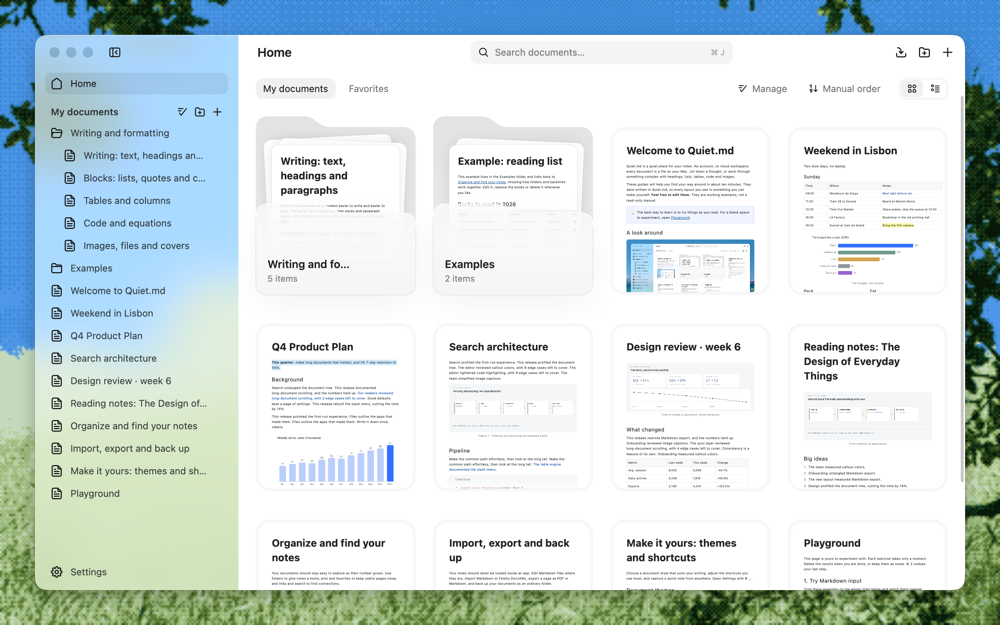

<h1 align="center">Quiet.md</h1>

  <b>빠르고 조용한 로컬 노트 앱.</b> 
  Rust + GPUI로 직접 그리는 네이티브 앱입니다. 노트는 Feishu(Lark) DocxXML 형식으로 내 컴퓨터에 저장됩니다.

  <a href="README.md">English</a> · <a href="README.zh-CN.md">简体中文</a> · <a href="README.ja.md">日本語</a> · 한국어 · <a href="README.es.md">Español</a> · <a href="README.fr.md">Français</a>

  
  
  
  
  
  

  
  &nbsp;
  
  &nbsp;
  

  <a href="https://quiet.md/?lang=en"><b>웹사이트</b></a> ·
  <a href="#다운로드"><b>다운로드</b></a> ·
  <a href="#성능">성능</a> ·
  <a href="#기능">기능</a> ·
  <a href="CONTRIBUTING.md">기여하기</a>

  

> [!NOTE]
> Quiet.md는 **베타** 단계이며 빠르게 바뀌고 있습니다. 버그를 발견했거나 아이디어가 있다면 [이슈를 남겨 주세요](https://github.com/s1dashu/quiet-md/issues). 풀 리퀘스트를 보내 주시면 더 좋습니다.

## Quiet.md를 쓰는 이유

**⚡ 빠릅니다. 네이티브다운 속도입니다.** 인터페이스 전체를 Rust와 [GPUI](https://www.gpui.rs/)로 GPU에서 그립니다. WebView도 Electron도 쓰지 않습니다. 100만 자짜리 문서에서도 입력, 삭제, 스크롤이 모두 P95 기준 프레임당 6 ms 안에 끝납니다.

**🔒 로컬 우선. 내 파일은 내 것입니다.** 계정도 클라우드도 없고, 기본 설정에서는 아무것도 네트워크로 보내지 않습니다(선택 사항인 업데이트 확인은 예외). 라이브러리는 컴퓨터에 있는 평범한 폴더입니다. 사이드바의 폴더는 실제 폴더이고, 노트 하나는 제목을 이름으로 한 파일 하나(`.xml`, Markdown은 `.md`)입니다. Git, iCloud 등 원하는 동기화 도구로 관리하면 됩니다. Quiet.md를 더 이상 쓰지 않게 되어도 파일은 그대로 남습니다.

**📝 Feishu(Lark) DocxXML을 그대로 쓰는 본격 리치 텍스트 에디터.** 노트는 Feishu(Lark) 문서가 쓰는 DocxXML 형식으로 저장되므로, 복사·붙여넣기, 가져오기, 내보내기를 해도 구조가 유지됩니다. 제목, 할 일, 표, 다단, 콜아웃, 코드, 수식, 이미지, 첨부 파일까지, 문서를 쓸 때 찾게 되는 블록이 모두 있습니다.

## 다운로드

  
  &nbsp;
  
  &nbsp;
  

| 플랫폼 | 패키지 | 요구 사항 |
|---|---|---|
| **macOS**(Apple Silicon) | [quiet-md-macos-arm64.zip](https://download.quiet.md/latest/quiet-md-macos-arm64.zip) | macOS 13 이상 |
| **Windows**(x64) | [quiet-md-windows-x64-setup.exe](https://download.quiet.md/latest/quiet-md-windows-x64-setup.exe) | Windows 10 버전 2004 이상 |
| **Linux**(x86_64, 실험적) | [quiet-md-x86_64.AppImage](https://download.quiet.md/latest/quiet-md-x86_64.AppImage) | glibc 2.35 이상(Ubuntu 22.04 이상) |
| **macOS**(Intel) | [quiet-md-macos-x86_64.zip](https://download.quiet.md/latest/quiet-md-macos-x86_64.zip) | macOS 13 이상 |

- **macOS**: 압축을 풀고 `quiet.md.app`을 응용 프로그램 폴더로 끌어다 놓습니다. 앱은 Apple의 서명과 공증을 받았습니다.
- **Windows**: 설치 프로그램을 실행합니다. 기본적으로 현재 사용자에게만 설치되며, 제거해도 노트는 지워지지 않습니다. 처음 실행할 때 SmartScreen 창이 뜨면 **추가 정보 → 실행**을 누르세요.
- **Linux**(실험적): `chmod +x quiet-md-*.AppImage` 후 실행합니다. FUSE가 없으면 `--appimage-extract-and-run`을 붙이세요. AppImage 0.1.10부터는 앱 안에서 업데이트할 수 있고, 그 이전 Linux 버전은 한 번 직접 설치해야 합니다. 직접 써 보는 테스트는 지금까지 Wayland의 Omarchy에서만 했습니다. 자세한 내용은 [Linux 안내](CONTRIBUTING.md#linux-experimental)를 참고하세요.

[Quiet.md](https://quiet.md/?lang=en)에서도 내려받을 수 있습니다. 모든 릴리스와 SHA-256 체크섬은 [GitHub Releases](https://github.com/s1dashu/quiet-md/releases)에 있습니다.

처음 실행하면 인터페이스 언어, 라이브러리 위치, 빠른 메모 단축키를 고르고, Obsidian, Logseq, iA Writer, Typora의 노트를 복사해 가져올 수 있습니다. 빈 라이브러리에는 **Getting started** 가이드가 들어갑니다. 주요 기능을 10분 만에 둘러보는 안내입니다. 이미 있는 노트는 덮어쓰지 않습니다.

인터페이스는 영어, 중국어 간체, 일본어, 한국어, 스페인어, 프랑스어로 제공됩니다.

## 성능

**100만 자**, 549개 장으로 이루어진 복합 문서에서 100번 연속으로 작업했을 때의 프레임 처리 시간입니다.

| 작업 | P50 | P95 |
|---|---:|---:|
| ⌨️ 입력 | **5.06 ms** | 5.78 ms |
| ⌫ Backspace | **4.99 ms** | 5.55 ms |
| 🖱️ 스크롤 | **2.08 ms** | 4.14 ms |

120 Hz 디스플레이에서 한 프레임에 쓸 수 있는 시간은 8.3 ms입니다. 100만 자 문서의 P95에서도 여유가 남습니다.

| | |
|---|---|
| macOS 다운로드 | 약 18 MB |
| Windows 설치 프로그램 | 약 14 MB |
| 런타임 | WebView 없음, Electron 없음, 백그라운드 서비스 없음 |

Apple M5 Pro / 48 GiB, macOS 26.5, 릴리스 빌드. 측정 방법과 재현 스크립트: [docs/PERFORMANCE.md](docs/PERFORMANCE.md)

## 기능

- **편집**: 제목, 번호 목록과 글머리 기호 목록, 할 일, 인용, 구문 강조가 되는 코드 블록, LaTeX 수식, 표(셀 병합 지원), 콜아웃, 다단, 이미지, 첨부 파일, 표지. `#`, `-`, `[]`, `>` 같은 Markdown 단축 입력과 `/` 슬래시 메뉴.
- **정리**: 문서 트리, 고정, 즐겨찾기, 전체 텍스트 검색, 휴지통.
- **가져오기와 내보내기**: Markdown 폴더(Obsidian 이미지 임베드와 콜아웃 포함)와 Feishu(Lark) DocxXML 가져오기, Markdown과 PDF로 내보내기, 바로 인쇄하기. Finder에서 홈이나 사이드바의 폴더로 파일을 끌어다 놓아 가져올 수 있습니다. Feishu나 웹 페이지에서 붙여넣어도 구조가 유지됩니다.
- **단축키**: `⌘ /`(Windows에서는 `Ctrl+/`)를 누르면 전체 목록이 나옵니다. 모든 단축키를 바꿀 수 있습니다. Windows에서는 ⌘ 대신 Ctrl, ⌥ 대신 Alt를 씁니다. 앱과 Getting started 가이드는 사용 중인 시스템에 맞는 키로 표시됩니다.
- **테마**: Craft, Feishu, Notion, Obsidian 네 가지 스타일을 기본으로 제공하고, 각각 다크 버전이 있습니다. CSS로 직접 테마를 만들 수도 있습니다. [docs/THEMES.md](docs/THEMES.md)를 참고하세요.

## 기여자

Quiet.md를 함께 만들어 주신 모든 분께 감사드립니다. 이슈와 풀 리퀘스트를 환영합니다. 빌드, 테스트, 코드 규칙은 [CONTRIBUTING.md](CONTRIBUTING.md)에 있습니다.

## 최근 업데이트

- **0.1.12**(11월 14일): Finder나 '이 컴퓨터의 파일'에서 사이드바의 폴더나 행 사이로 바로 끌어다 놓아 가져오기. 끄는 동안 페이지 전체가 놓을 곳이 됩니다. 홈 카드를 연속 곡선 모서리로 새로 단장, 'Finder에서 열기' 추가, 경로 표시는 '내 문서'에서 시작, 창 최소 너비가 노트 영역을 확보, 전체 화면에서는 사이드바가 불투명. 폴더 안에서 문서를 만들 때 멈출 수 있던 문제 수정.
- **0.1.11**(11월 13일): 라이브러리가 실제 폴더가 되고 파일 이름은 제목을 따릅니다. 이전 라이브러리는 백업 후 자동으로 옮겨집니다. 언어, 라이브러리 위치, 빠른 메모 단축키를 정하고 Obsidian 등 Markdown 앱의 노트를 가져오는 새 첫 실행 화면. 일본어·스페인어·한국어 인터페이스, Markdown 블록 수식, 마지막으로 읽던 위치로 돌아가기, 더 빠른 시작과 적은 메모리 사용.
- **0.1.10**(11월 10일): ‘새로 만들기’ 메뉴에서 문서 종류를 고를 수 있고, 넓은 표를 가로로 스크롤할 수 있습니다. Markdown 표의 열 정렬을 저장할 때 유지하고, 긴 입력란에서도 캐럿이 계속 보입니다.
- **0.1.9**(11월 8일): macOS에서 Cmd+Q로 종료되지 않던 문제, Windows에서 창 버튼이 반응하지 않던 문제, 글자 배경색에 선택 영역이 가려지던 문제를 고쳤습니다.
- **0.1.8**(11월 9일): 로컬 Markdown 파일을 그 자리에서 편집하고, `.md`를 유지한 채 폴더를 가져오고, 여러 단계의 폴더에서 끌어서 옮기고 실행 취소하며 노트를 정리할 수 있습니다. 이미지와 미리보기의 메모리 사용량을 줄이고, 표 크기 조절을 안정시키고 메뉴를 다듬었습니다. 처음 실행할 때 지원되는 시스템 언어를 고릅니다. 실험적인 Linux AppImage 패키지를 추가했습니다.
- **0.1.7**(11월 6일): 여러 창에서의 저장, 충돌 복구, 디스크 쓰기를 더 안전하게 했습니다. 내보내기가 접근할 수 있는 파일을 제한했고, Markdown으로 내보낼 때 인라인 첨부 파일을 유지합니다. Windows에서 Weasel(小狼毫)로 중국어를 입력할 때 글자가 지워지던 문제를 고쳤습니다.
- **0.1.6**(11월 6일): 창 전환과 입력이 더 매끄러워졌고, 표를 더 넓게 쓸 수 있으며, 계속 입력하는 동안에도 주기적으로 저장합니다. macOS에서는 Option+Space로 어디서든 빠른 노트를 엽니다. Windows는 이미지 붙여넣기, PDF 내보내기와 인쇄를 지원하고, 단어 단위 삭제를 바로잡았습니다.
- **0.1.5**(11월 5일): 앱 이름이 Quiet.md로 바뀌었습니다. 라이브러리와 노트는 원래 자리에 그대로 있습니다.
  - 홈에서 여러 문서를 한 번에 관리할 수 있습니다. 한꺼번에 복제하고, 옮기고, 삭제할 수 있습니다.
  - 휴지통을 한 번에 비울 수 있습니다. 화살표 키로 삽입 메뉴의 아이콘 사이를 이동합니다. 모든 문서를 지워도 빈 문서가 새로 생기지 않습니다.
  - 앱 안에서 업데이트한 뒤에는 새 버전에서 바뀐 점을 사이드바에 한 번 보여 줍니다.
  - Windows: 단축키와 내장 가이드가 Ctrl / Alt로 표시되고, 실행에 실패하면 이유를 알려 주고 로그를 남깁니다.
- **0.1.4**(11월 5일):
  - 앱 안에서 업데이트: 새 버전이 나오면 사이드바 위쪽에 **업데이트** 버튼이 나타납니다. 내려받은 파일은 서명으로 검증하고, 다시 시작하면 설치가 끝납니다. 열려 있는 문서는 먼저 저장합니다. 자동 확인은 **설정 › 일반**에서 끌 수 있습니다. 확인할 때는 버전 매니페스트만 가져오고 어떤 데이터도 보내지 않습니다. 0.1.3 이하 버전에서는 0.1.4를 한 번 직접 내려받아야 합니다.
  - 다크 모드: **설정 › 모양**에서 시스템 설정, 라이트, 다크 중 하나를 고릅니다. 기본 테마와 직접 만든 테마 모두 다크 모양이 있습니다. 내보내기와 인쇄는 밝은 모양 그대로입니다.
- **0.1.3**(11월 4일): macOS가 다크 모드일 때도 사이드바 글자가 다시 잘 보입니다.
- **0.1.2**(11월 4일): macOS 표준 메뉴와 단축키(Hide, Minimize, Zoom, Full Screen)를 지원합니다. 마지막 창을 닫은 뒤에도 Dock 아이콘을 누르면 창이 다시 열립니다. 일부 중국어 글자가 잘못된 글리프로 표시되던 문제를 고쳤습니다.
- **0.1.1**(11월 3일): 첫 Windows x64 릴리스입니다. 사용자별로 설치되고, 제거해도 노트는 남습니다. 중국어와 영어 인터페이스, 내장 가이드를 다듬었습니다.

버전별 전체 릴리스 노트는 [Releases](https://github.com/s1dashu/quiet-md/releases)에 있습니다.

## 라이선스

코드는 [MIT](LICENSE) 라이선스를 따릅니다. 서드파티 코드, 글꼴, 에셋은 [THIRD_PARTY.md](THIRD_PARTY.md)에 정리되어 있습니다.

다음은 MIT 라이선스에 포함되지 않으므로, 포크에서는 다른 것으로 바꿔야 합니다.

- `assets/icons/`에 있는 Nucleo 아이콘 67개는 Nucleo 상용 라이선스를 따릅니다. 아이콘만 따로 추출하거나 재배포하지 마세요.
- "Quiet.md"라는 이름과 앱 아이콘.
