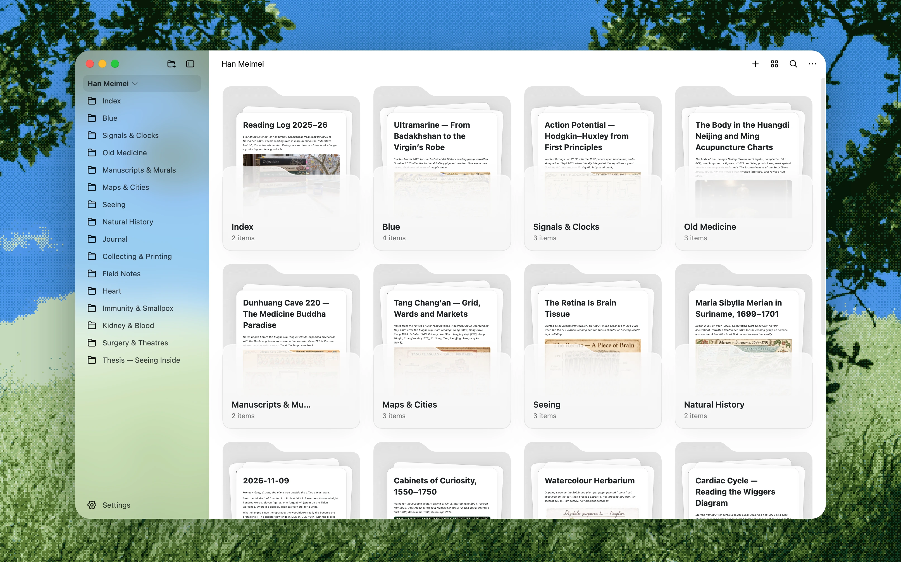
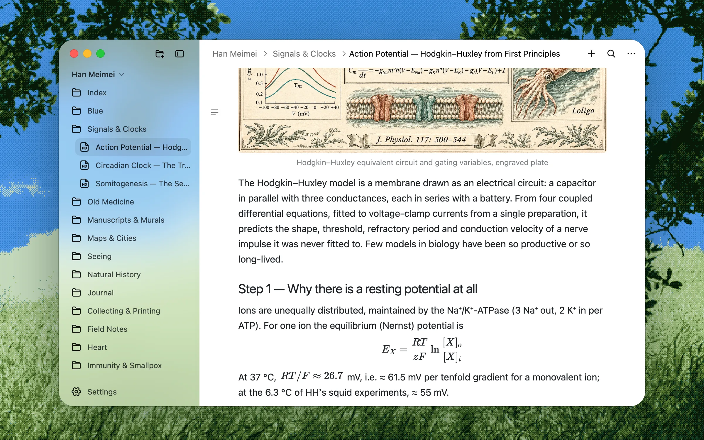

<h1 align="center">Quiet.md</h1>

  <b>Ghi chú nhanh, yên tĩnh, nằm ngay trên máy tính của bạn.</b> 
  Một ứng dụng ghi chú native viết bằng Rust + GPUI: thư mục thật, Markdown tự định dạng, và một bảng trắng ngay trong ghi chú của bạn. Miễn phí và mã nguồn mở.

  <a href="README.md">English</a> · <a href="README.zh-CN.md">简体中文</a> · <a href="README.zh-TW.md">繁體中文</a> · <a href="README.ja.md">日本語</a> · <a href="README.ko.md">한국어</a> · <a href="README.es.md">Español</a> · <a href="README.fr.md">Français</a> · Tiếng Việt

  
  
  
  
  
  

  
  &nbsp;
  
  &nbsp;
  

  <a href="https://quiet.md/?lang=en"><b>Trang web</b></a> ·
  <a href="#tải-xuống"><b>Tải xuống</b></a> ·
  <a href="#tính-năng">Tính năng</a> ·
  <a href="#hiệu-năng">Hiệu năng</a> ·
  <a href="CONTRIBUTING.md">Đóng góp</a>

  

> [!NOTE]
> Quiet.md đang ở giai đoạn **beta** và thay đổi nhanh chóng. Nếu bạn gặp lỗi hoặc có ý tưởng, hãy [mở một issue](https://github.com/s1dashu/quiet-md/issues) — hoặc tốt hơn nữa, gửi một pull request.

## Vì sao chọn Quiet.md

**📁 Ghi chú của bạn chỉ là những tệp tin.** Không tài khoản, không đám mây, và theo mặc định không có gì đi qua mạng, ngoại trừ việc kiểm tra cập nhật tùy chọn, số liệu sử dụng ẩn danh hằng ngày của công cụ dòng lệnh `quiet` (`quiet telemetry off`), và các lần tải phông chữ do bạn kích hoạt: phông chữ viết tay cho tiếng Trung, tiếng Nhật và tiếng Hàn trong lần đầu tiên một bảng trắng cần đến nó, và một phông chữ tài liệu có thể tải xuống khi bạn chọn. Mỗi thư mục trong thanh bên là một thư mục thật trên ổ đĩa của bạn, và mỗi ghi chú là một tệp tin mang tên tiêu đề của nó: `.md` cho Markdown, `.xml` cho tài liệu giàu định dạng. Đồng bộ chúng bằng iCloud, Git hay bất cứ thứ gì bạn thích. Nếu một ngày bạn ngừng dùng Quiet.md, các tệp tin của bạn vẫn ở nguyên chỗ cũ.

**⚡ Native, và nhanh.** Toàn bộ giao diện được Rust và [GPUI](https://www.gpui.rs/) vẽ trên GPU. Không Electron, không WebView. Trong một ghi chú một triệu ký tự, việc gõ phím tốn khoảng 5 ms mỗi khung hình, còn một màn hình 120 Hz cho phép 8,3.

**✍️ Viết và vẽ ở cùng một nơi.** Gõ `#`, `-`, `[]` hay `>` và Markdown tự định dạng. Khi từ ngữ không đủ, hãy đặt một bảng trắng ngay trong ghi chú. Ghi chú giàu định dạng được lưu ở định dạng DocxXML của Feishu (Lark), nên việc dán từ Feishu hay một trang web vẫn giữ được cấu trúc của nó.

## Tính năng

### Viết

  

Tiêu đề, danh sách, việc cần làm, trích dẫn, khung chú thích (callout), cột, bảng có ô gộp, mã nguồn với tô sáng cú pháp, công thức toán LaTeX, hình ảnh, tệp tin và ảnh bìa. Các phím tắt Markdown hoạt động ngay khi bạn gõ, và menu `/` có mọi thứ còn lại. Nhắc đến một ghi chú khác để liên kết tới nó; ghi chú đó sẽ liệt kê các backlink của nó.

### Vẽ

  

Board là một bảng trắng được chuyển từ Excalidraw: hình khối, mũi tên bám dính theo, vẽ tự do, văn bản, ghi chú dính (sticky note), khung và hình ảnh. Đặt một bảng vào trong một ghi chú, hoặc giữ nó như một tệp `.excalidraw` mà excalidraw.com mở được. Thu phóng bằng cách chụm trên bàn di chuột; một bảng với 10.000 hình khối vẫn mượt.

### Sắp xếp trong thư mục thật

Home hiển thị mỗi thư mục như một chồng các trang của nó. Giữ một ghi chú phía trên một thư mục và thư mục sẽ mở ra cho bạn; thư mục lồng trong thư mục, và các thao tác di chuyển có thể hoàn tác. Ghim và đánh dấu yêu thích ghi chú, tìm kiếm mọi tiêu đề và dòng bằng `⌘ J`, và tìm và thay thế trong một ghi chú, dùng biểu thức chính quy nếu bạn thích. Ghi chú đã xóa chờ trong Trash. Các tệp và thư mục Markdown ở nơi khác trên máy tính của bạn có thể được mở trong mục **Files on this computer** và chỉnh sửa ngay tại chỗ của chúng.

### Mang theo ghi chú của bạn

  

Trong lần khởi chạy đầu tiên, Quiet.md tìm các thư viện Obsidian, Logseq, iA Writer và Typora của bạn và sao chép chúng vào, giữ nguyên bản gốc. Các `[[wikilinks]]` của Obsidian vẫn hoạt động: nhấp vào một liên kết để mở ghi chú mà nó trỏ tới. Về sau, kéo các tệp và thư mục Markdown thả vào Home hoặc thẳng vào một thư mục trong thanh bên. Ghi chú xuất ra lại dưới dạng Markdown hoặc PDF, hoặc in thẳng ra máy in.

### Làm việc với agent

Công cụ dòng lệnh `quiet` cho phép một AI agent (Claude Code, Codex, hay bất kỳ MCP client nào) đọc, tìm kiếm và chỉnh sửa cùng thư viện mà bạn viết trong đó. Nó tìm các khối theo dàn ý, chỉnh sửa qua cùng một engine như ứng dụng, viết lại liên kết khi ghi chú di chuyển, thêm hàng vào bảng dữ liệu và vẽ lên bảng, và từ chối ghi đè những gì bạn đã thay đổi kể từ khi nó đọc. Một ghi chú bạn đang mở sẽ tiếp nhận chỉnh sửa của agent ngay khi nó đến, mỗi lần lưu giữ lại văn bản trước đó như một phiên bản, và `quiet run` nhận cả một kịch bản JavaScript như một thay đổi duy nhất, được ghi trọn vẹn hoặc không ghi gì cả. `quiet skill install` cung cấp cho Claude Code và Codex một skill, để chúng tìm đến `quiet` mỗi khi bạn hỏi về ghi chú của mình; các client không có shell dùng `quiet mcp`. `quiet` đếm xem những lệnh nào của nó chạy mỗi ngày, dưới một id ngẫu nhiên và không bao giờ kèm ghi chú của bạn, và gửi các số đếm đó mỗi ngày một lần; `quiet telemetry off`, `DO_NOT_TRACK=1` hoặc tắt kiểm tra cập nhật tự động của ứng dụng sẽ dừng việc này.

`quiet` đi kèm trong ứng dụng. Trên macOS, đưa nó vào PATH của bạn bằng `ln -s /Applications/quiet.md.app/Contents/MacOS/quiet /usr/local/bin/quiet`; trên Windows nó nằm cạnh `quiet_md.exe` trong thư mục cài đặt. Xem [docs/design/CLI.md](docs/design/CLI.md).

### Và hơn nữa

- **Lịch sử phiên bản**: mỗi ghi chú giữ các bản chụp nhanh mỗi khi lưu (mặc định 20, tối đa 30). Mở một bản để xem những gì đã thay đổi ngay tại chỗ, khôi phục nó bằng một cú nhấp, hoặc đặt tên cho nó.
- **Ghi chú nhanh**: trên macOS, một phím tắt toàn cục (`⌥ Space` theo mặc định) mở một cửa sổ ghi chú nhỏ phía trên mọi ứng dụng.
- **Phong cách của bạn**: bốn phong cách có sẵn — Craft, Feishu, Notion và Obsidian — mỗi phong cách có một biến thể tối, hoặc CSS của riêng bạn ([docs/THEMES.md](docs/THEMES.md)). Chọn phông chữ cho giao diện và tài liệu.
- **Phím của bạn**: nhấn `⌘ /` để xem mọi phím tắt, và gán lại bất kỳ phím nào trong số chúng. Trên Windows và Linux, Ctrl thay cho ⌘ và Alt thay cho ⌥.
- **Ngôn ngữ của bạn**: tiếng Anh, tiếng Trung giản thể, tiếng Trung phồn thể, tiếng Nhật, tiếng Hàn, tiếng Tây Ban Nha, tiếng Pháp, tiếng Ả Rập và tiếng Thổ Nhĩ Kỳ. Văn bản tiếng Ả Rập nối các chữ cái của nó và chạy từ phải sang trái.
- **Dọn dẹp**: Settings › Documents tìm các hình ảnh và tệp tin mà không ghi chú nào dùng nữa và chuyển chúng đi sau khi bạn xác nhận.
- **Cập nhật**: các phiên bản mới cài đặt từ bên trong ứng dụng sau khi chữ ký của chúng được xác minh. Việc kiểm tra tự động có thể tắt.

## Tải xuống

  
  &nbsp;
  
  &nbsp;
  

| Nền tảng | Gói | Yêu cầu |
|---|---|---|
| **macOS** (Apple Silicon) | [quiet-md-macos-arm64.dmg](https://download.quiet.md/latest/quiet-md-macos-arm64.dmg) | macOS 13 trở lên |
| **Windows** (x64) | [quiet-md-windows-x64-setup.exe](https://download.quiet.md/latest/quiet-md-windows-x64-setup.exe) | Windows 10 phiên bản 1809 trở lên |
| **Linux** (x86_64, thử nghiệm) | [quiet-md-x86_64.AppImage](https://download.quiet.md/latest/quiet-md-x86_64.AppImage) | glibc 2.35 trở lên (Ubuntu 22.04 và mới hơn) |
| **macOS** (Intel) | [quiet-md-macos-x86_64.dmg](https://download.quiet.md/latest/quiet-md-macos-x86_64.dmg) | macOS 13 trở lên |

- **macOS**: mở tệp `.dmg` và kéo `quiet.md.app` vào lối tắt Applications bên cạnh nó, rồi mở nó từ Applications. Ứng dụng và ảnh đĩa đều được Apple ký và công chứng. Tệp `.zip` trên trang Releases chứa cùng ứng dụng đó; đó là thứ mà tính năng cập nhật trong ứng dụng tải xuống.
- **Windows**: chạy trình cài đặt. Theo mặc định nó chỉ cài cho người dùng hiện tại, và việc gỡ cài đặt không bao giờ xóa ghi chú của bạn. Nếu SmartScreen xuất hiện trong lần khởi chạy đầu tiên, hãy nhấp **Thông tin thêm → Vẫn chạy**.
- **Linux** (thử nghiệm): `chmod +x quiet-md-*.AppImage` và chạy nó; nếu không có FUSE, thêm `--appimage-extract-and-run`. AppImage 0.1.10 trở đi hỗ trợ cập nhật trong ứng dụng; các phiên bản Linux cũ hơn cần cài đặt thủ công một lần. Việc kiểm thử tương tác đến nay bao phủ Omarchy trên Wayland; xem [ghi chú về Linux](CONTRIBUTING.md#linux-experimental).

Bạn cũng có thể tải xuống từ [Quiet.md](https://quiet.md/?lang=en). Mọi bản phát hành cùng các tổng kiểm tra SHA-256 của chúng đều nằm trên [GitHub Releases](https://github.com/s1dashu/quiet-md/releases).

Trong lần khởi chạy đầu tiên, Quiet.md hỏi về ngôn ngữ giao diện, nơi giữ thư viện của bạn và phím tắt ghi chú nhanh, và đề nghị sao chép vào các ghi chú từ Obsidian, Logseq, iA Writer hoặc Typora. Một thư viện trống nhận được một hướng dẫn **Getting started** — một chuyến tham quan mười phút qua các tính năng chính. Các ghi chú hiện có không bao giờ bị ghi đè.

## Hiệu năng

Thời gian xử lý khung hình qua 100 thao tác liên tiếp trong một tài liệu hỗn hợp gồm **1 triệu ký tự** và 549 chương:

| Thao tác | P50 | P95 |
|---|---:|---:|
| ⌨️ Gõ phím | **5.06 ms** | 5.78 ms |
| ⌫ Backspace | **4.99 ms** | 5.55 ms |
| 🖱️ Cuộn | **2.08 ms** | 4.14 ms |

Một màn hình 120 Hz dành cho mỗi khung hình 8.3 ms. Ngay cả ở P95 trên một tài liệu một triệu ký tự, vẫn còn dư dả.

| | |
|---|---|
| Bản tải xuống macOS | ~18 MB |
| Trình cài đặt Windows | ~14 MB |
| Runtime | Không WebView, không Electron, không dịch vụ nền |

Apple M5 Pro / 48 GiB, macOS 26.5, bản dựng release. Phương pháp và các kịch bản để tái tạo: [docs/PERFORMANCE.md](docs/PERFORMANCE.md).

## Người đóng góp

Cảm ơn mọi người đã giúp xây dựng Quiet.md. Issue và pull request luôn được chào đón: việc xây dựng, kiểm thử và các quy ước mã nguồn nằm trong [CONTRIBUTING.md](CONTRIBUTING.md).

## Cập nhật gần đây

- **0.1.14** (22 tháng 11): tìm và thay thế bằng biểu thức chính quy. Các `[[wikilinks]]` của Obsidian mở ghi chú mà chúng trỏ tới. Một giao diện tiếng Thổ Nhĩ Kỳ, và tiếng Ả Rập được bố cục từ phải sang trái. Chọn phông chữ giao diện và tài liệu, và dọn các hình ảnh và tệp tin mà không ghi chú nào dùng. Tìm kiếm theo kịp các thư viện lớn, và việc xóa nhiều ghi chú nhanh hơn. Một cài đặt cho việc phím Backspace có quay về tiêu đề hay không; trên Windows và Linux, Copy as Markdown giờ là Ctrl+Shift+M.
- **0.1.13** (17 tháng 11): board — một bảng trắng được chuyển từ Excalidraw, dưới dạng một khối trong một ghi chú hoặc một tệp `.excalidraw` độc lập, nhanh với 10.000 hình khối. Lịch sử phiên bản cho mọi ghi chú (… › Version history). Giao diện tiếng Pháp và tiếng Ả Rập. Copy as Markdown, sao chép đường dẫn của một tệp, và chuyển thư mục thư viện trong Settings. Các hình ảnh web được dán vào được lưu vào thư viện. Ít bộ nhớ hơn trên các trang nhiều hình ảnh và cuộn thanh bên mượt hơn.
- **0.1.12** (14 tháng 11): kéo tệp từ Finder, hoặc một tệp từ Files on this computer, thẳng vào một thư mục trong thanh bên hoặc giữa các hàng; toàn bộ trang sáng lên như một mục tiêu thả. Các thẻ Home được thiết kế lại với các góc squircle, một menu Open in Finder, các breadcrumb bắt đầu từ My documents, một chiều rộng cửa sổ tối thiểu giữ chỗ cho ghi chú, và một thanh bên liền khối trong chế độ toàn màn hình. Sửa một lỗi treo khi tạo tài liệu trong một thư mục.
- **0.1.11** (13 tháng 11): thư viện giờ là các thư mục thật, với các tệp mang tên tiêu đề; các thư viện cũ tự động chuyển qua, kèm một bản sao lưu. Một lần khởi chạy đầu tiên mới đặt ngôn ngữ, vị trí thư viện và phím tắt ghi chú nhanh và nhập ghi chú từ Obsidian và các ứng dụng Markdown khác. Giao diện tiếng Nhật, tiếng Tây Ban Nha và tiếng Hàn; công thức toán dạng hiển thị trong Markdown; tài liệu mở lại ở nơi bạn đã rời đi; khởi chạy nhanh hơn và dùng ít bộ nhớ hơn.
- **0.1.10** (10 tháng 11): chọn một loại tài liệu từ menu New, cuộn các bảng rộng theo chiều ngang, giữ căn chỉnh cột của Markdown, và giữ con trỏ hiển thị trong các trường dài.
- **0.1.9** (8 tháng 11): sửa Cmd+Q trên macOS, các nút điều khiển cửa sổ không phản hồi trên Windows, và vùng chọn văn bản bị các màu tô sáng che mất.
- **0.1.8** (9 tháng 11): chỉnh sửa các tệp Markdown cục bộ ngay tại chỗ, nhập các thư mục trong khi giữ `.md`, và sắp xếp ghi chú trong các thư mục lồng nhau bằng kéo và hoàn tác. Dùng ít bộ nhớ hơn cho hình ảnh và bản xem trước; thay đổi kích thước bảng ổn định hơn và các menu tinh tế hơn. Lần khởi chạy đầu tiên chọn một ngôn ngữ hệ thống được hỗ trợ. Đóng gói AppImage cho Linux thử nghiệm.
- **0.1.7** (6 tháng 11): lưu nhiều cửa sổ an toàn hơn, khôi phục xung đột và ghi đĩa; hạn chế quyền truy cập tệp khi xuất; các bản xuất Markdown giữ các tệp đính kèm nội tuyến. Sửa lỗi xóa ký tự khi nhập tiếng Trung bằng Weasel trên Windows.
- **0.1.6** (6 tháng 11): chuyển cửa sổ và gõ phím mượt hơn, các bảng rộng hơn, lưu đều đặn trong khi gõ liên tục, và Option+Space cho ghi chú nhanh toàn cục trên macOS. Windows thêm dán hình ảnh, xuất PDF và in, cùng việc sửa lỗi xóa từ.
- **0.1.5** (5 tháng 11): ứng dụng giờ được gọi là Quiet.md; thư viện và ghi chú của bạn vẫn ở nguyên chỗ của chúng.
  - Quản lý nhiều tài liệu cùng lúc từ Home: nhân bản, di chuyển hoặc xóa chúng cùng nhau.
  - Dọn sạch Trash trong một bước; các phím mũi tên di chuyển qua các biểu tượng của menu chèn; việc xóa mọi tài liệu không còn tạo ra một tài liệu trống.
  - Sau một lần cập nhật trong ứng dụng, thanh bên hiển thị một lần những gì đã thay đổi trong phiên bản mới.
  - Windows: các phím tắt và hướng dẫn tích hợp đọc là Ctrl / Alt, và một lần khởi chạy thất bại tự giải thích chính nó và để lại một bản ghi.
- **0.1.4** (5 tháng 11):
  - Cập nhật trong ứng dụng: khi một phiên bản mới ra mắt, một nút **Update** xuất hiện ở đầu thanh bên. Bản tải xuống được xác minh theo chữ ký của nó, và một lần khởi động lại hoàn tất việc cài đặt; các tài liệu đang mở được lưu trước. Việc kiểm tra tự động có thể tắt trong **Settings › General**. Một lần kiểm tra chỉ lấy một bản kê khai phiên bản và không gửi dữ liệu nào. Phiên bản 0.1.3 và cũ hơn cần tải xuống thủ công một lần bản 0.1.4.
  - Chế độ tối: chọn System, Light hoặc Dark trong **Settings › Appearance**. Các theme tích hợp và tùy chỉnh đều có một diện mạo tối; việc xuất và in ấn vẫn giữ sáng.
- **0.1.3** (4 tháng 11): văn bản của thanh bên đọc được trở lại khi macOS ở chế độ tối.
- **0.1.2** (4 tháng 11): các menu và phím tắt chuẩn của macOS (Hide, Minimize, Zoom, Full Screen); việc nhấp vào biểu tượng Dock mở lại một cửa sổ sau khi cửa sổ cuối cùng đã đóng. Sửa một số ký tự tiếng Trung hiển thị sai glyph.
- **0.1.1** (3 tháng 11): bản phát hành Windows x64 đầu tiên, được cài theo từng người dùng, giữ lại ghi chú của bạn khi gỡ cài đặt. Trau chuốt giao diện tiếng Trung và tiếng Anh cùng hướng dẫn tích hợp.

Ghi chú đầy đủ cho mỗi phiên bản nằm trên [Releases](https://github.com/s1dashu/quiet-md/releases).

## Giấy phép

Mã nguồn được cấp phép theo [MIT](LICENSE). Mã nguồn, phông chữ và tài nguyên của bên thứ ba được liệt kê trong [THIRD_PARTY.md](THIRD_PARTY.md).

Những điều sau đây không nằm trong giấy phép MIT và nên được thay thế trong các fork:

- 71 biểu tượng Nucleo trong `assets/icons/` thuộc giấy phép thương mại của Nucleo. Đừng trích xuất hoặc phân phối lại chúng một cách riêng lẻ.
- Tên "Quiet.md" và biểu tượng của ứng dụng.
