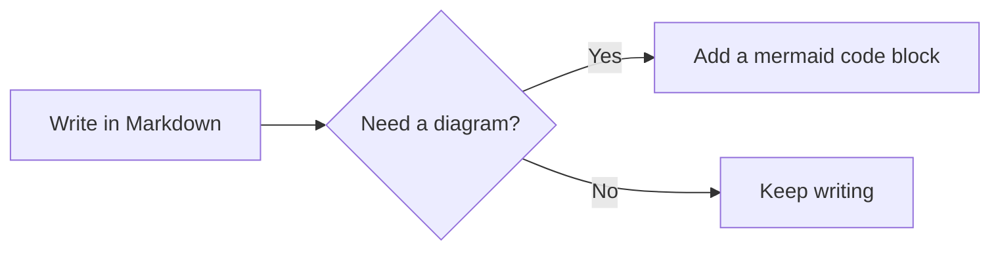

# A plain Markdown file

This page is an ordinary `.md` file in your documents folder. Any Markdown editor can open it, and Quiet.md edits it where it is: the front matter above and the spacing of lines you do not change stay exactly as they were.

## Lists

- Headings start with `#`
- Lists start with `-`, `*` or `1.`
  - Indent to nest them
- [x] Tasks are a GFM extension
- [ ] Try ticking this one

> A quote starts with `>`.

## Code

```python
def greet(name):
    return f"Hello, {name}!"
```

## A diagram

A code block whose language is `mermaid` is drawn as a diagram, as on GitHub or in Obsidian. In the file it stays an ordinary code block, so an editor that does not draw Mermaid shows the code.


