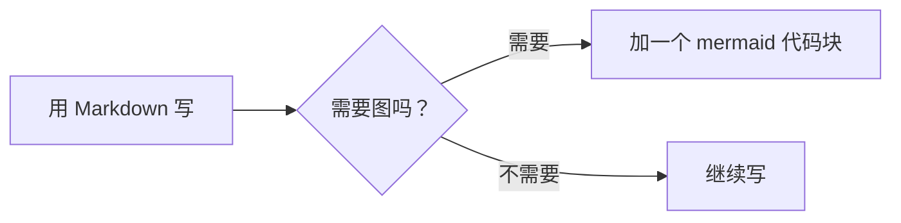

# 一个普通的 Markdown 文件

这一页是文档文件夹里一个普通的 `.md` 文件，任何 Markdown 编辑器都能打开。Quiet.md 原地编辑它：上面的 front matter，以及你没改动的行的空行和写法，都原样保留。

## 列表

- 标题以 `#` 开头
- 列表以 `-`、`*` 或 `1.` 开头
  - 缩进可以嵌套
- [x] 任务列表是 GFM 扩展
- [ ] 试着勾选这一项

> 引用以 `>` 开头。

## 代码

```python
def greet(name):
    return f"你好，{name}！"
```

## 图表

语言写成 `mermaid` 的代码块会画成图，和 GitHub、Obsidian 一样。文件里它仍是一个普通的代码块，在不画 Mermaid 的编辑器里显示为代码。


